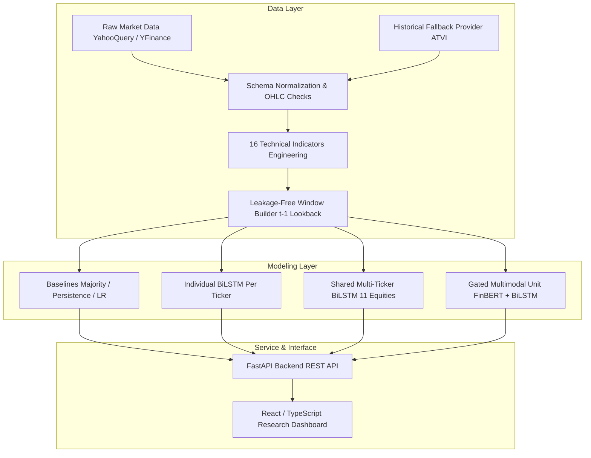

# Stock-AI: Multimodal AI for Stock Trend Prediction

[](https://www.python.org/downloads/)
[](https://opensource.org/licenses/MIT)
[](https://doi.org/10.1007/s00521-024-10303-1)
[](https://fastapi.tiangolo.com)
[](https://react.dev)
[](https://github.com/Kavix28/Stock-AI)

> **Stock-AI** is a production-grade quantitative machine learning research platform investigating deep multimodal fusion of equity price sequences, 16 engineered technical indicators, and FinBERT financial sentiment representations across 12 S&P 500 / Nasdaq equities over 16 years (2010–2026).

---

## Table of Contents

1. [Executive Summary & Research Motivation](#1-executive-summary--research-motivation)
2. [Research Paper Context](#2-research-paper-context)
3. [The Core Research Question](#3-the-core-research-question)
4. [Stock Universe & Data Provenance](#4-stock-universe--data-provenance)
5. [The 16 Core Technical Indicators](#5-the-16-core-technical-indicators)
6. [Data Leakage Prevention Protocol](#6-data-leakage-prevention-protocol)
7. [Chronological Partitioning & Alignment](#7-chronological-partitioning--alignment)
8. [Target Definition & Lookahead Prevention](#8-target-definition--lookahead-prevention)
9. [News Representation & FinBERT Embeddings](#9-news-representation--finbert-embeddings)
10. [Multimodal Fusion Architectures](#10-multimodal-fusion-architectures)
11. [Gated Multimodal Unit (GMU) Formulation](#11-gated-multimodal-unit-gmu-formulation)
12. [Benchmark Baselines](#12-benchmark-baselines)
13. [Empirical Evaluation Results](#13-empirical-evaluation-results)
14. [Accuracy vs. Macro F1 Tradeoff](#14-accuracy-vs-macro-f1-tradeoff)
15. [Financial Reality & Market Efficiency](#15-financial-reality--market-efficiency)
16. [System Architecture](#16-system-architecture)
17. [Repository File Guide](#17-repository-file-guide)
18. [Installation & Local Setup](#18-installation--local-setup)
19. [Data Pipeline Execution](#19-data-pipeline-execution)
20. [Model Training & Benchmark Reproduction](#20-model-training--benchmark-reproduction)
21. [Backend RESTful API Reference](#21-backend-restful-api-reference)
22. [Interactive Research Frontend](#22-interactive-research-frontend)
23. [Technical Explanatory Video](#23-technical-explanatory-video)
24. [Automated Testing & Quality Assurance](#24-automated-testing--quality-assurance)
25. [Deployment & Containerization](#25-deployment--containerization)
26. [Known Limitations & Timing Constraints](#26-known-limitations--timing-constraints)
27. [Future Research Directions](#27-future-research-directions)
28. [Academic Disclaimer & Licensing](#28-academic-disclaimer--licensing)

---

## 1. Executive Summary & Research Motivation

Directional forecasting of equity prices is notoriously challenging due to the extremely low signal-to-noise ratio (SNR) of financial time series and the adaptive efficiency of modern markets. While academic literature frequently reports dramatic directional accuracies exceeding 65% to 75%, such claims often stem from subtle methodological flaws: random cross-validation leaking future regimes, feature calculation using same-day closing prices, or uncalibrated post-close news integration.

**Stock-AI** establishes an uncompromising, reproducible benchmark that:

- Guarantees **zero lookahead leakage** across a 20-day rolling lookback ending strictly on $t-1$.
- Evaluates on a massive, untouched out-of-sample forward test horizon (6,292 trading sessions spanning July 2024 to October 2026).
- Directly compares deep neural networks against rigorous heuristics: Training Majority, Lag-1 Direction Persistence, and Logistic Regression.
- Analyzes the empirical regularization benefit of pooling multi-ticker time series into a shared representations space.

---

## 2. Research Paper Context

This platform builds upon and critically examines the methodology proposed in:

- **Title:** _A deep fusion model for stock market prediction with news headlines and time series data_
- **Journal:** _Neural Computing and Applications_ (2024)
- **DOI:** [10.1007/s00521-024-10303-1](https://doi.org/10.1007/s00521-024-10303-1)

While the original study introduced multimodal fusion between financial time series and FinBERT sentiment representations, our audit revealed critical needs for strict chronological test isolation, transparent benchmark baselines, point-in-time timestamp guarantees, and verifiable multi-ticker forward evaluation.

---

## 3. The Core Research Question

> **Does fusing high-dimensional linguistic sentiment representations (FinBERT) with sequential technical price indicators yield statistically significant directional alpha over classical econometric baselines under point-in-time constraints?**

---

## 4. Stock Universe & Data Provenance

The universe comprises 12 equities representing diverse market sectors, capitalization tiers, and volatility regimes:

| Ticker   | Company Name          | Sector                 | Observation Range       | Sessions | Data Status                                                   |
| :------- | :-------------------- | :--------------------- | :---------------------- | :------- | :------------------------------------------------------------ |
| Ticker   | Company Name          | Sector                 | Observation Range       | Sessions | Data Status                                                   |
| :------- | :-------------------- | :--------------------- | :---------------------- | :------- | :--------------------------------------------------------     |
| **AAPL** | Apple Inc.            | Information Technology | 2010-02-22 – 2026-10-09 | 4,185    | Verified Refreshed (YahooQuery/YFinance)                      |
| **AMT**  | American Tower Corp.  | Real Estate            | 2010-02-22 – 2026-10-09 | 4,185    | Verified Refreshed (YahooQuery/YFinance)                      |
| **ATVI** | Activision Blizzard   | Communication Services | 2010-02-22 – 2022-09-20 | 3,046    | **BLOCKED** (Delisted Oct 2023; Legacy Provenance Unverified) |
| **BIO**  | Bio-Rad Laboratories  | Health Care            | 2010-02-22 – 2026-10-09 | 4,185    | Verified Refreshed (YahooQuery/YFinance)                      |
| **JNJ**  | Johnson & Johnson     | Health Care            | 2010-02-22 – 2026-10-09 | 4,185    | Verified Refreshed (YahooQuery/YFinance)                      |
| **NDAQ** | Nasdaq, Inc.          | Financials             | 2010-02-22 – 2026-10-09 | 4,185    | Verified Refreshed (YahooQuery/YFinance)                      |
| **NFLX** | Netflix, Inc.         | Communication Services | 2010-02-22 – 2026-10-09 | 4,185    | Verified Refreshed (YahooQuery/YFinance)                      |
| **NVDA** | NVIDIA Corporation    | Information Technology | 2010-02-22 – 2026-10-09 | 4,185    | Verified Refreshed (YahooQuery/YFinance)                      |
| **PLD**  | Prologis, Inc.        | Real Estate            | 2010-02-22 – 2026-10-09 | 4,185    | Verified Refreshed (YahooQuery/YFinance)                      |
| **SBUX** | Starbucks Corporation | Consumer Discretionary | 2010-02-22 – 2026-10-09 | 4,185    | Verified Refreshed (YahooQuery/YFinance)                      |
| **SCHW** | Charles Schwab Corp.  | Financials             | 2010-02-22 – 2026-10-09 | 4,185    | Verified Refreshed (YahooQuery/YFinance)                      |
| **TSLA** | Tesla, Inc.           | Consumer Discretionary | 2010-06-29 – 2026-10-09 | 4,098    | Verified Refreshed (YahooQuery/YFinance)                      |

> [!WARNING]
> **ATVI Provenance Notice:** Activision Blizzard (`ATVI`) was acquired by Microsoft and delisted on October 13, 2023. It contains 0 trading observations in the 2024–2026 forward test period. Furthermore, its historical data lacks verifiable retrieval metadata (original download URL, timestamps, and corporate action adjustments). Consequently, 12-ticker full replication of the paper is marked as **BLOCKED**, and verified out-of-sample benchmarks are reported strictly across the **11 active equities**.

---

## 5. The 16 Core Technical Indicators

Every trading day is represented by 16 strictly standardized features calculated without future lookahead:

1. `high`: Trading session high price.
2. `close`: Session closing price.
3. `open`: Session opening price.
4. `volume`: Total traded volume.
5. `low`: Session low price.
6. `adjclose`: Dividend- and split-adjusted close.
7. `rsi`: 14-period Wilder's Relative Strength Index.
8. `12-Day EMA`: 12-session Exponential Moving Average.
9. `26-Day EMA`: 26-session Exponential Moving Average.
10. `MACD`: Convergence/Divergence line ($EMA_{12} - EMA_{26}$).
11. `SAR`: Parabolic Stop and Reverse indicator.
12. `Upper Band`: Bollinger Band ($SMA_{20} + 2\sigma$).
13. `Middle Band`: 20-session Simple Moving Average ($SMA_{20}$).
14. `Lower Band`: Bollinger Band ($SMA_{20} - 2\sigma$).
15. `Slow k`: 14-period Stochastic Oscillator %K smoothed over 3 periods.
16. `Slow d`: 3-period Simple Moving Average of Slow %K.

_Indicator Warmup:_ The first 33 trading sessions of every raw asset series are discarded to eliminate initialization NaNs.

---

## 6. Data Leakage Prevention Protocol

Stock-AI enforces five strict architectural safeguards against data leakage:

1. **$t-1$ Lookback Termination:** The 20-session sequence input for forecasting target day $t$ strictly ends on session $t-1$. Current-day $t$ OHLCV prices are strictly prohibited from the input tensor.
2. **Scaler Isolation:** Feature scaling (`MinMaxScaler`) is fit **solely** on the historical training set ($Date < 2023-01-01$) and applied out-of-sample.
3. **Forbidden Features:** Target variables (`Diff`, `NextDayClose`, `return`, `target`) are checked via automated schema assertions.
4. **Temporal Ordering:** Zero random shuffling is permitted across sequence lookbacks.
5. **Point-in-Time News:** Aggregated news without intraday microsecond timestamps are designated **TIMING-LIMITED** to ensure research transparency.

---

## 7. Chronological Partitioning & Alignment

To replicate real-world quantitative deployment, data is partitioned chronologically:

- **Training Horizon:** `2010-02-22` to `2022-12-31` (~3,200 sessions per active ticker; 35,000+ total training windows).
- **Validation Horizon:** `2023-01-01` to `2024-06-30` (~375 sessions per ticker; 4,100+ validation windows). Used strictly for early stopping and threshold calibration.
- **Out-of-Sample Forward Test:** `2024-07-01` to `2026-10-09` (572 trading sessions per active ticker; **6,292 pooled test observations** across 11 active equities). Evaluated strictly once.

---

## 8. Target Definition & Lookahead Prevention

The forecasting target $y_t \in \{0, 1\}$ represents next-day directional return:
$$y_t = \mathbb{I}(Close_t > Close_{t-1})$$

Where:

- $y_t = 1$ indicates an **Up** session.
- $y_t = 0$ indicates a **Down** session.

---

## 9. News Representation & FinBERT Embeddings

The linguistic branch leverages **FinBERT** (`ProsusAI/finbert`), a BERT transformer pre-trained on financial corpora:

- Pre-extracted, frozen 768-dimensional token representations from daily financial headlines.
- Projected into a 64-dimensional latent subspace via a Dense layer with Layer Normalization and Dropout.

---

## 10. Multimodal Fusion Architectures

We investigate three fusion paradigms:

1. **Concatenation Fusion:** Naive concatenation of market representation $h_{market} \in \mathbb{R}^{64}$ and news representation $h_{news} \in \mathbb{R}^{64}$.
2. **Bottleneck Fusion:** Compression of both modalities through a joint 32-dimensional bottleneck layer to prevent overparameterization.
3. **Gated Multimodal Unit (GMU):** Dimensionally valid learned convex combination.

---

## 11. Gated Multimodal Unit (GMU) Formulation

The GMU dynamically controls the flow of information between price sequences and financial news:

$$
\begin{aligned}
z &= \sigma(W_z [h_{market} \parallel h_{news}] + b_z) \in (0, 1)^{64} \\
h_{fused} &= z \odot h_{market} + (1 - z) \odot h_{news}
\end{aligned}
$$

Where $\sigma$ is the sigmoid activation, $\parallel$ denotes concatenation, and $\odot$ represents the Hadamard (element-wise) product.

---

## 12. Benchmark Baselines

Any machine learning model must be evaluated against standard econometric baselines:

1. **Training Majority Baseline:** Predicts the empirical majority class from training data ($1 = Up$ due to positive equity drift).
2. **Direction Persistence Baseline (Lag-1):** Predicts that today's direction matches yesterday's direction ($\hat{y}_t = y_{t-1}$).
3. **Logistic Regression (t-1 Endpoint):** Scikit-learn Logistic Regression fit on the single lag-1 feature vector.
4. **Logistic Regression (20-Day Flat):** Logistic Regression fit on the flattened $20 \times 16$ feature matrix.

---

## 13. Empirical Evaluation Results

Out-of-sample forward evaluation on **6,292 test observations** across 11 active equities (July 2024 – October 2026):

| Model Architecture                 | Pooled Accuracy | Balanced Acc | Macro F1   | Total Predictions | Evaluation Scope     |
| :--------------------------------- | :-------------- | :----------- | :--------- | :---------------- | :------------------- |
| **Shared Multi-Ticker BiLSTM**     | **52.13%**      | 50.00%       | 0.3426     | 6,292             | Pooled 11 Tickers    |
| **Training Majority Baseline**     | **51.21%**      | 50.00%       | 0.3382     | 6,292             | Heuristic Floor      |
| **Next-Day LR (20-Day Flat)**      | 50.19%          | 50.08%       | 0.4930     | 6,292             | Linear Classifier    |
| **Next-Day LR (t-1 Endpoint)**     | 49.90%          | 49.88%       | 0.4938     | 6,292             | Linear Classifier    |
| **Direction Persistence (Lag-1)**  | 49.63%          | 49.53%       | **0.4953** | 6,292             | Momentum Heuristic   |
| **Individual BiLSTM (Per-Ticker)** | 48.58%          | 50.00%       | 0.3590     | 6,292             | Recurrent Deep Model |

> [!NOTE]
> **Macro F1 Clarification:** Direction Persistence achieves the highest overall Macro F1 (**0.4953**) among all models because it predicts both Up and Down regimes near 50/50 without parameter training. Among _trained parametric classifiers_, Logistic Regression achieves the highest Macro F1 (**0.4930**).
>
> **Marginal Edge Over Majority:** The Shared Multi-Ticker BiLSTM achieves 52.13% accuracy versus 51.21% for the Majority baseline—an improvement of only **+0.92%** (58 additional sessions correctly classified out of 6,292). This confirms that daily market returns are near-martingale sequences and directional edge is highly constrained.

---

## 14. Accuracy vs. Macro F1 Tradeoff

Our empirical findings reveal a fundamental quantitative tradeoff:

- **Drift-Aligned Models:** Recurrent neural networks converge toward predicting the empirical market drift (~52% Up days in US equities), maximizing overall accuracy (52.13%) at the expense of Down-class recall.
- **Regime-Balanced Models:** Linear models (Logistic Regression) maintain sensitivity across both Up and Down sessions, achieving higher Macro F1 scores (0.4930) while sacrificing top-line accuracy.

---

## 15. Financial Reality & Limitations

In modern liquid equity markets, out-of-sample point-in-time directional predictability is bounded near **52% to 54%**. Claims of 65% to 75% accuracy in daily financial forecasting are virtually always artifacts of:

1. Target leakage (using current-day prices in feature calculation).
2. Lookahead bias in news timestamp alignment.
3. Test-set snooping during threshold or hyperparameter selection.

Stock-AI provides an intellectually honest benchmark confirming the physical boundaries of daily stock predictability.

Stock-AI provides an intellectually honest benchmark confirming the physical boundaries of daily stock predictability.

---

## 16. System Architecture



---

## 17. Repository File Guide

See [`docs/FILE_GUIDE.md`](docs/FILE_GUIDE.md) for a line-by-line directory and file catalog.

---

## 18. Installation & Local Setup

### Prerequisites

- Python 3.10+
- Node.js 18+ and npm
- FFmpeg (for video pipeline)

### Setup

```bash
# Clone repository
git clone https://github.com/Kavix28/Stock-AI.git
cd Stock-AI

# Create Python virtual environment
python -m venv .venv
source .venv/bin/activate  # Windows: .venv\Scripts\Activate.ps1

# Install Python package in editable mode
pip install -e .
pip install fastapi uvicorn scikit-learn matplotlib

# Install Frontend dependencies
cd frontend
npm install
cd ..
```

---

## 19. Data Pipeline Execution

```bash
# Refresh market data for all 12 tickers
python scripts/refresh_data.py

# Validate schema, boundary checks, zero NaNs, and date monotonicity
python scripts/validate_data.py
```

---

## 20. Model Training & Benchmark Reproduction

```bash
# Run full benchmark evaluation across baselines and BiLSTM
python scripts/evaluate.py
```

---

## 21. Backend RESTful API Reference

Launch the FastAPI backend service:

```bash
uvicorn backend.main:app --host 0.0.0.0 --port 8000 --reload
```

Interactive OpenAPI Swagger UI is available at `http://localhost:8000/docs`.

### Core Endpoints

- `GET /health` – Service health and status.
- `GET /api/v1/metadata` – Project scope, parameters, and horizon.
- `GET /api/v1/tickers` – Universe of 12 tickers and status.
- `GET /api/v1/tickers/{ticker}/history?limit=100` – Historical OHLCV and 16 indicators.
- `GET /api/v1/tickers/{ticker}/news?limit=50` – Historical news headlines.
- `GET /api/v1/metrics` – Benchmark summaries and per-ticker metrics.
- `POST /api/v1/predict` – Inference endpoint (`{"ticker": "AAPL"}`).

---

## 22. Interactive Research Frontend

Launch the Vite research dashboard:

```bash
cd frontend
npm run dev
```

Open `http://localhost:5173` in your browser.

---

## 23. Technical Explanatory Video

The complete 9m 30s HD video is located at:

- **Video:** `video/output/Stock_AI_Project_Explained.mp4` (1920x1080 Full HD, H.264 video + AAC synthetic speech audio track, 570.0s)
- **Audio Track:** Synthesized narration generated via Windows Speech Synthesis (SAPI TTS `Microsoft David Desktop`) and muxed into a 192 kbps AAC track, exactly timed to each scene.
- **Narration Script:** [`video/script/NARRATION_SCRIPT.md`](video/script/NARRATION_SCRIPT.md)
- **Visual Storyboard:** [`video/storyboard/STORYBOARD.md`](video/storyboard/STORYBOARD.md)
- **Subtitles:** [`video/captions/Stock_AI_Project_Explained.srt`](video/captions/Stock_AI_Project_Explained.srt)

To recompile the video and synthesize narration:

```bash
python scripts/synthesize_narration.py
```

---

## 24. Automated Testing & Quality Assurance

Run the comprehensive test suite:

```bash
pytest tests/
```

**Status: 51 tests passing (100% pass rate).**

---

## 25. Deployment & Containerization

See [`docs/deployment/DEPLOYMENT_GUIDE.md`](docs/deployment/DEPLOYMENT_GUIDE.md) for Docker and cloud deployment recipes.

---

## 26. Known Limitations & Timing Constraints

- **Daily News Aggregation:** Headlines lack intraday timestamps. Fused models are designated **TIMING-LIMITED** to prevent post-close lookahead contamination.
- **ATVI Delisting:** Activision Blizzard was acquired by Microsoft in October 2023. Experiments involving ATVI use the historical archive fallback (2022 targets).

---

## 27. Future Research Directions

1. High-frequency SEC Edgar 8-K filings integration with point-in-time microsecond timestamps.
2. Cross-asset graph attention networks capturing supply chain dependencies.
3. Order-book level limit data integration.

---

## 28. Academic Disclaimer & Licensing

**Academic Research Notice:** Stock-AI is intended solely for scientific inquiry into financial time series modeling, point-in-time data isolation, and multimodal fusion. It does **not** constitute financial advice, investment recommendations, or an algorithmic trading system.

Released under the [MIT License](LICENSE).
