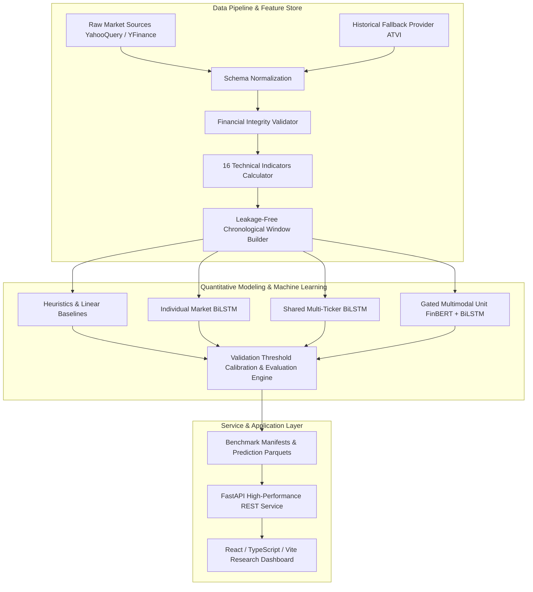

# Stock-AI System Architecture

This document specifies the technical architecture, modular subsystem boundaries, data pipelines, and design patterns governing Stock-AI.

---

## 1. High-Level Subsystem Architecture

Stock-AI is organized as a three-tier modular quantitative platform:

---

## 2. Component Design Principles

### A. Point-in-Time Isolation & Leakage Prevention

- **Rolling Lookback:** A 20-trading-day window terminating at $t-1$ supplies features for forecasting session $t$.
- **Preprocessing Scope:** Feature normalization parameters ($\mu, \sigma$ or $\min, \max$) are fit **solely** on historical training partitions ($Date < 2023-01-01$). Under no circumstances is the full dataset normalized prior to temporal splitting.
- **Warmup Truncation:** Technical indicators with recursive or rolling lookbacks (e.g., 26-period EMA, 20-period Bollinger Bands) have the first 33 trading sessions permanently dropped to guarantee zero NaN values enter model inputs.

### B. Clean Architecture & Separation of Concerns

1. **`src/stock_ai/data/`**: Handles ingestion, raw file preservation, provider abstractions, and temporal windowing.
2. **`src/stock_ai/features/`**: Pure mathematical indicator transformations.
3. **`src/stock_ai/models/`**: Deep learning and econometric model definitions.
4. **`src/stock_ai/evaluation/`**: Strictly isolated metrics computation and validation threshold calibration.
5. **`src/stock_ai/inference/`**: Zero-fabrication prediction serving.
6. **`backend/`**: Lightweight REST API layer.
7. **`frontend/`**: Decoupled, responsive single-page application.

---

## 3. Technology Stack & Dependencies

- **Language & Runtime:** Python 3.10+, Node.js 18+
- **Machine Learning & Modeling:** Scikit-learn, TensorFlow / Keras, NumPy, Pandas
- **Web API:** FastAPI, Uvicorn, Pydantic v2
- **Frontend:** React 18, Vite 5, TypeScript 5, Recharts, Lucide React
- **Multimedia:** Matplotlib, FFmpeg
